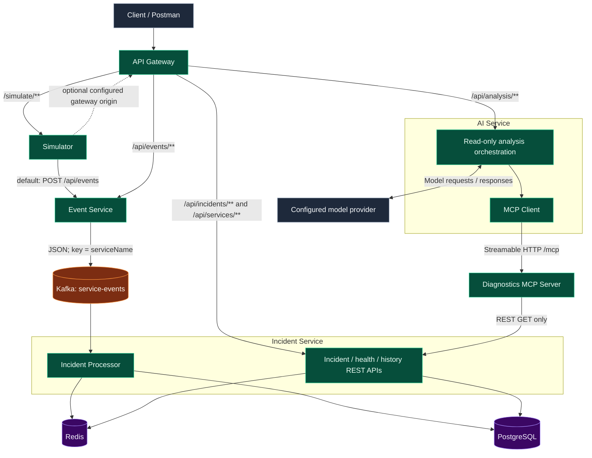
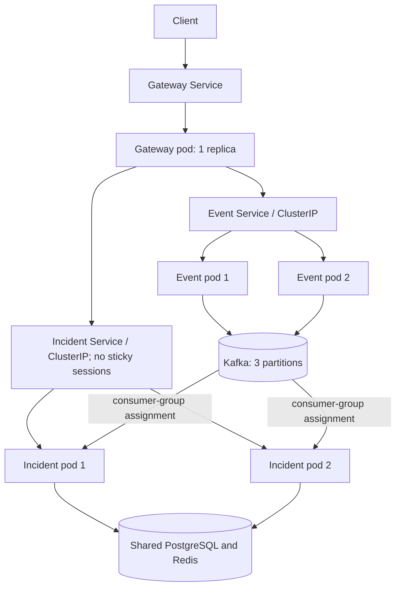

# Incident Response Platform

Deterministic incident detection with read-only, evidence-grounded AI diagnostics.

A six-service Java platform that accepts operational events, delivers them through Kafka, correlates failures in Redis, and persists incidents in PostgreSQL. A separate AI service investigates existing incidents through narrowly scoped Model Context Protocol (MCP) tools. The LLM does not detect failures, create incidents, change their status, or execute recommendations.

This is a local-development and portfolio project, not an internet-ready incident-management product.

[Architecture](#architecture) · [Docker quick start](#docker-quick-start) · [Five-minute demo](#five-minute-demo-warm-stack) · [API examples](#example-api-requests) · [Kubernetes](#kubernetes-deployment) · [Testing](#testing-strategy) · [Limitations](#known-limitations)

## Problem being solved

A burst of backend errors is not the same thing as an actionable incident. Repeated delivery can inflate error counts, separate components can fail independently, and a model can produce plausible explanations without reliable observations.

This project separates those concerns:

- **Ingestion and delivery:** validate events and acknowledge Kafka publication independently of the consumer.
- **Detection:** apply explicit failure thresholds, deduplicate event IDs, and suppress repeated automatic incidents for an already-active root service.
- **Investigation:** retrieve observed incident, health and event data through read-only tools before asking a model for a hypothesis.
- **Operations:** expose testable APIs, structured trace-correlated logs, metrics, and local container/Kubernetes deployment examples.

## Architecture

Solid arrows show the default runtime paths. The incident processor is part of `incident-service`; the MCP client is embedded in `ai-analysis-service`. Neither is an additional microservice.



**Routing distinction:** the gateway receives the simulation trigger, but the default Compose/Kubernetes simulator submits directly to event-service. The dashed Simulator → Gateway → Event Service path is an optional existing configuration: a native simulator can use the gateway origin as `EVENT_SERVICE_BASE_URL`. It is not the default deployment path. Internal services remain independently accessible; the gateway is not a security boundary.

AI analysis is explicitly requested by a caller after an incident exists. Incident creation does not automatically invoke a model.

## Docker quick start

Prerequisites: Docker Desktop running Linux containers and Docker Compose. Docker builds supply Java 21/Maven; a host JDK is needed for native development/tests, not for starting these images. Run commands in Windows PowerShell from the repository root.

```powershell
if (-not (Test-Path -LiteralPath '.env')) {
    Copy-Item -LiteralPath '.env.example' -Destination '.env'
}
notepad.exe .env
```

In your private `.env`, set `DB_NAME`, `DB_USERNAME`, `DB_PASSWORD`, `DB_PORT`, `OPENAI_API_KEY`, `OPENAI_MODEL`, and `GRAFANA_ADMIN_PASSWORD`. The template supplies nonsecret database names/ports and leaves credentials/model selection blank. The complete stack requires nonempty AI key/model and Grafana password; starting it does not itself call the model. Keep existing database/Grafana credentials when reusing volumes.

```powershell
docker compose config --quiet
docker compose up --build -d --wait --wait-timeout 300
if ($LASTEXITCODE -ne 0) { throw 'Stack startup failed; inspect before running a demo.' }
docker compose ps --all
```

Expect eleven healthy long-running containers and `kafka-init` successfully exited. Cold image/dependency downloads can take longer than the demo below. Image assembly skips tests deliberately; it is not a test result.

Default loopback URLs:

| Entry point | URL |
| --- | --- |
| Gateway | `http://127.0.0.1:8081` |
| MCP, direct Streamable HTTP | `http://127.0.0.1:8084/mcp` |
| Prometheus targets | `http://127.0.0.1:9090/targets` |
| Grafana dashboard | `http://127.0.0.1:3000/d/incident-response` |

Grafana uses your configured private login. All published Compose ports bind to `127.0.0.1`. Use [Docker operations and isolated demos](docs/docker.md) for every port override, internal DNS, fresh projects, smoke options and safe shutdown. Use [native Windows development](docs/local-development.md) to run individual applications without containerizing them; `.env` does not automatically populate native Java processes.

```powershell
# Stops this Compose project; preserves named data volumes.
docker compose down
```

Do not add `-v`/`--volumes` as routine cleanup. Never commit `.env`, provider keys, database passwords, kubeconfig or Kubernetes Secret values, or share unrestricted rendered configuration/environment dumps.

## Five-minute demo (warm stack)

This short walkthrough starts **after** images are built and the complete stack is healthy, with default five-event/five-error settings and the `service-events` topic. Fresh installation/build time is excluded. To demonstrate a new incident, the selected deployment must have no previous `order-service` incident/history/correlation state; use a [fresh isolated project](docs/docker.md#fresh-isolated-demo-alongside-an-existing-stack), not a volume reset.

From the repository root, against a fresh default-project/default-port stack:

```powershell
powershell.exe -NoProfile -File .\scripts\smoke-docker.ps1 -WaitSeconds 60
```

The bounded script performs the demo rather than just printing sample output:

1. Sends one `POST /simulate/database-failure` through the gateway.
2. Verifies five acknowledged events against actual Kafka records and persisted REST history, including their shared trace and exact event IDs.
3. Checks the Redis correlation members, a newly created OPEN incident and DOWN service health.
4. Prints the actual incident ID and retains synthetic records for inspection.

For the **complete failure-to-analysis path**, choose this invocation **instead of** the previous one:

```powershell
# Opt-in: sends operational evidence to the provider and can incur charges.
powershell.exe -NoProfile -File .\scripts\smoke-docker.ps1 -WaitSeconds 60 -IncludeAi -AiTimeoutSeconds 120
```

This adds one analysis HTTP POST and validates captured MCP evidence, probable cause and recommendations. Model rounds are bounded, but provider response time/success is not guaranteed; the provider-free walkthrough is the predictable short-demo option. Do not run both creation checks consecutively against retained state. A repeated simulator call generates new event IDs, while an existing active incident suppresses another automatic creation.

For an alternate project/port, pass its exact `-ProjectName`, `-EnvFile` and `-Gateway` as shown in the Docker guide. The script rejects a native or unrelated gateway. This walkthrough is not a throughput or latency benchmark.

## Complete event flow

1. A caller invokes a simulator scenario through `/simulate/**` on the gateway. The simulator generates unique event UUIDs and one shared trace ID; it contains no detection logic.
2. The simulator posts each event to event-service over HTTP. Direct clients can alternatively submit events through gateway `/api/events/**`.
3. Event-service validates the DTO, assigns an omitted event ID, and publishes JSON to Kafka keyed by `serviceName`. **202 means broker acknowledgement**, not completed processing; unconfirmed publication returns 503.
4. The incident-service Kafka listener validates/deserializes the record and delegates to its transactional event processor.
5. PostgreSQL atomically inserts `event_id` if absent. An already-committed ID returns as a duplicate without changing the original row or incrementing Redis correlation.
6. A newly inserted ERROR/CRITICAL event updates Redis's atomic processing-time failure windows. INFO/WARNING events remain durable history but do not contribute to detection.
7. At the configured threshold, a PostgreSQL advisory lock serializes the active-incident check/create for that root service. With no OPEN/INVESTIGATING incident, the processor creates one. The event and any new incident commit together in PostgreSQL.
8. Kafka's record acknowledgement follows successful processing. Infrastructure failures propagate for retry; invalid/poison records are skipped so later valid records can proceed.
9. Clients retrieve incident, health and history DTOs through gateway routes or incident-service directly.
10. For an explicitly requested analysis, the AI service opens a scoped MCP session, obtains required observations, and asks the configured model to synthesize a hypothesis. Additional tool reads remain bounded and scoped. Recommendations are returned, not executed.

There is no distributed atomic transaction spanning Kafka, Redis and PostgreSQL. See [idempotency](#idempotency-strategy) and [limitations](#known-limitations).

## Technologies and rationale

| Technology | Why it is used |
| --- | --- |
| Java 21, Maven wrapper | Consistent language/runtime and a reproducible multi-module build. |
| Spring Boot 4.0.9, MVC, Validation | Independent HTTP services, DTO validation, configuration and controlled errors. |
| Spring Cloud Gateway / Cloud BOM 2025.1.4 | Configuration-driven routing without embedding domain logic in the gateway. |
| Kafka 4.1.2, KRaft | Durable asynchronous delivery and consumer-group partition ownership; no ZooKeeper. |
| Redis 8.2 | Atomic sorted-set failure windows and transient recent-error state. |
| PostgreSQL 17, JPA/JDBC, Flyway | Durable incident/event data, SQL uniqueness/locking and versioned schema validation. |
| Spring AI 2.0.1, MCP Java SDK | ChatModel integration and explicit, read-only diagnostic tool transport. |
| Spring Cloud CircuitBreaker / Resilience4j | Bounded resilience at synchronous diagnostic-read boundaries only. |
| Micrometer, Prometheus, Grafana | Application/JVM/HTTP metrics, scraping and a provisioned dashboard. |
| Docker Compose, Kubernetes/Kustomize | A complete local stack and a separate Service-DNS/replica demonstration. |
| JUnit Jupiter 5.13.4, Mockito, MockMvc, Testcontainers | Business/controller tests and real PostgreSQL/Kafka/Redis integration tests. |
| Python unittest, Pester | Packaging/manifest/observability contracts and offline PowerShell script tests. |

Versions are the repository's pins, not claims about the latest releases. No model is used to make incident-detection decisions.

## Microservices and responsibilities

| Module | Default HTTP port | Responsibility | Kubernetes replicas |
| --- | --- | --- | --- |
| `api-gateway` | 8081 | Forward five configured route families; no data-store/model clients. | 1 |
| `event-service` | 8082 | Validate events, assign missing IDs, await Kafka acknowledgement. | 2 |
| `incident-service` | 8080 | Consume/persist events, correlate failures, manage incidents, derive health/history. | 2 |
| `service-simulator` | 8083 | Generate normal/database/payment/cascade scenarios through HTTP only. | 1 |
| `diagnostics-mcp-server` | 8084 | Expose five read-only tools using incident-service REST APIs only. | 1 |
| `ai-analysis-service` | 8085 | Gather scoped MCP evidence and validate bounded model-assisted analysis. | 1 |

`order-service`, `payment-service` and `inventory-service` are identities in simulated events, not additional implemented business microservices.

## Kafka topic

| Setting | Default |
| --- | --- |
| Topic | `service-events` |
| Partitions | 3 |
| Local replication factor | 1 |
| Record key | `serviceName` |
| Value | JSON ServiceEvent; no Java class-name headers |
| Consumer group | `incident-processors` |
| Consumer commit | Auto-commit disabled; record acknowledgement after processing |

The idempotent initializer owns topic creation. Keep `KAFKA_EVENTS_TOPIC` consistent across producer, consumer and initializer. Same-service keys preserve partition-local ordering, not global order or equal work distribution. Consumer membership changes can rebalance partitions; extra consumers beyond the partition count do not add partition-level parallelism.

Delivery is at least once. Database/Redis processing failures retry with the configured interval; malformed/invalid records are skipped without a dead-letter topic. A producer timeout may occur after publication, so a deliberate retry should preserve the original `eventId`.

## Redis correlation

The default rule is **at least five distinct ERROR/CRITICAL events for one service in a sliding 60-second processing-time window**. Redis server time, not the event's source timestamp, scores UUID members. Atomic Lua operations prune old entries, deduplicate IDs, count failures and refresh expiry.

| Key for order-service | Purpose |
| --- | --- |
| `errors:{order-service}` | Configurable correlation-window failures. |
| `errors:{order-service}:critical` | CRITICAL members still inside that window. |
| `health-errors:{order-service}` | Separate, fixed 60-second recent-error view for health. |

The braces are literal Redis hash tags. The correlation threshold/window are externally configurable. A new incident is CRITICAL if the current window contains a CRITICAL failure, otherwise HIGH. An existing OPEN/INVESTIGATING incident suppresses another automatic creation for that root service; it is not automatically escalated or updated.

Health defaults to DOWN for an active HIGH/CRITICAL incident or at least five minute-window errors; two through four means DEGRADED, otherwise HEALTHY. This is event-derived health, not a reachability probe. A severe unresolved incident can keep a service DOWN after counters expire. Redis is ephemeral and does not reconstruct its windows from old PostgreSQL rows after restart.

## PostgreSQL schema overview

Flyway owns the schema; Hibernate uses `ddl-auto=validate`, never create/update.

| Business table | Fields and constraints |
| --- | --- |
| `incidents` | UUID `id` primary key; `title`, `status`, `severity`, `root_service`, `created_at`, `updated_at`, `error_count`; status/severity/nonblank/count checks; index on `status`. |
| `incident_events` | UUID `event_id` primary key; `service_name`, `event_type`, `severity`, `message`, source `timestamp`, nullable `trace_id`, and `processed_at`. |

See [V1](incident-service/src/main/resources/db/migration/V1__create_incidents_table.sql) and [V2](incident-service/src/main/resources/db/migration/V2__create_incident_events_table.sql). Instants are normalized to PostgreSQL microsecond precision. Event metadata travels through Kafka but is not stored in this event table. There is no incident-event foreign key or stored list of triggering event IDs; diagnostic event relationships are heuristic, not a database join proving causality.

## Idempotency strategy

`ServiceEvent.eventId` is the durable idempotency key. Inside the processing transaction, PostgreSQL executes `INSERT ... ON CONFLICT (event_id) DO NOTHING`. Only a newly inserted row proceeds to correlation, avoiding a check-then-insert race under concurrent delivery.

- A duplicate preserves the first committed payload and processing timestamp and does not recount failures or create another incident.
- The PostgreSQL gate remains effective after Redis expiry/restart while the event row is retained.
- Failed PostgreSQL processing rolls back the event/incident transaction so Kafka can retry. Redis's UUID membership protects a not-yet-committed retry within its window.
- A transaction-scoped PostgreSQL advisory lock serializes automatic incident creation per root service across application replicas.

This is not a cross-store exactly-once guarantee. Redis changes are not rolled back by a PostgreSQL rollback; cache expiry/loss between retries remains a documented limitation. A new simulator invocation generates new IDs and is not a replay of the previous invocation.

## MCP architecture

The embedded MCP client connects to the diagnostics server's **Streamable HTTP `/mcp`** endpoint. The server has no PostgreSQL, Redis or Kafka client: it obtains every observation through incident-service's REST API.

| Tool | Argument | Observation / REST boundary |
| --- | --- | --- |
| `get_incident` | `incidentId` | `GET /api/incidents/{id}`. |
| `get_service_health` | `serviceName` | `GET /api/services/{name}/health`. |
| `get_error_frequency` | `serviceName` | Error count/rate derived from that health response's 60-second window. |
| `get_recent_errors` | `serviceName` | Bounded history scan; ERROR/CRITICAL events filtered by processing time. |
| `get_related_events` | `incidentId` | Incident lookup followed by bounded root-service history around incident creation. |

Related events use `ROOT_SERVICE_TIME_WINDOW`, by default 60 seconds before/after creation, not causal or cross-service tracing. Scans default to five pages of 100 rows and report truncation/coverage. Concurrent history changes or repeated event IDs across pages can make coverage incomplete. Partial/empty results must not be treated as proof that no failures exist.

Tool results expose structured `success`, `data`, and safe `error` fields; inspect MCP `isError` as well as HTTP status. [Manual MCP/Postman examples](docs/api-examples.md#manual-mcp-requests) explain initialization/session headers. There are no `/get_incident` REST routes and no gateway MCP proxy.

## AI grounding strategy

Analysis uses an explicit bounded workflow around Spring AI `ChatModel`, not an unrestricted autonomous agent:

1. Validate the incident UUID and open a per-analysis MCP session scoped to that incident/root service.
2. Require `get_incident`, `get_related_events`, and `get_service_health` before calling the model. Retrieve recent errors when current errors or incomplete/empty related history make them useful.
3. Capture actual tool data in an application-owned evidence ledger (`E1`, `E2`, ...). The model cannot replace captured facts.
4. Permit only the five read-only tools, exact argument shapes, and the requested incident/root service; reject unknown tools, mutations and cross-scope requests.
5. Bound model rounds, tool calls, evidence size and response size. Defaults are three model rounds and eight diagnostic calls including preflight.
6. Validate the structured draft and its evidence references; force LOW confidence when coverage is incomplete. Return captured evidence, a probable-cause hypothesis and human-reviewed recommendations.

Incident/event text is treated as untrusted data. Missing diagnostics/provider failures return controlled errors, not invented analysis. Reference/schema checks do not prove every sentence of free-text reasoning. The public response contains `evidence`, not the internal draft's `evidenceIds` field.

Resilience applies only to incident-service REST GETs and allowlisted MCP diagnostic reads: default two total attempts with bounded time/concurrency and circuit breaking. There are **no blind retries** of gateway writes, simulator submissions, model calls or an entire analysis. Per-boundary time limits are not one global analysis deadline. See [read resilience](diagnostics-mcp-server/README.md) and [the configuration reference](.env.example).

## Kubernetes deployment

The [Kubernetes guide](kubernetes/README.md) covers explicit local-context selection, image builds/loads, separate database/provider Secrets, readiness and inspection. Complete those prerequisites before applying:

```powershell
kubectl config current-context
kubectl get nodes
kubectl apply -k .\kubernetes
kubectl -n incident-response get deployments,pods,services
```

Use only an intended local cluster, not an unknown/production context. Internal ClusterIP Services provide DNS and connection distribution. ConfigMaps hold nonsecret settings; Secret references deliver credentials only to the workloads that need them. Actuator startup/readiness/liveness probes and resource bounds are configured.



Event and incident Deployments start with two replicas; gateway, simulator, AI and diagnostics each start with one. Diagnostics MCP sessions are in memory: do not blindly scale that service behind nonsticky routing. PostgreSQL/Kafka use local persistent claims; Redis remains ephemeral. This is not HA infrastructure. Prometheus/Grafana deployment is supplied in Compose, not in these Kubernetes manifests.

The existing image tags `stage14`/`stage15` are local demo labels, not released versions. Build from the current checkout, load those exact manifest tags, and restart workloads deliberately; previously running pods do not update when Compose images are rebuilt.

## Load-balancing demonstration

After Kubernetes deployment, select its kubeconfig in the current PowerShell terminal and run:

```powershell
kubectl -n incident-response rollout status deployment/incident-service --timeout=300s
powershell.exe -NoProfile -File .\kubernetes\demo-load-balancing.ps1 -Requests 20
```

The script starts a fresh curl process inside the gateway pod for each read of `http://incident-service:8080/api/instance`. It addresses **Service DNS**, never picks a backend, and reports actual OS hostnames, which naturally identify pods. It requires at least two distinct responding Ready incident pods; it does not invent a balanced split.

Kubernetes Service networking distributes connections; persistent connections can reuse one backend and strict round-robin/equal counts are not guaranteed. A Service port-forward can pin one pod and is not this demonstration. `/api/instance` is not a gateway HTTP route: the gateway pod is only the curl client's location.

Kafka partition assignment is separate from HTTP load balancing. Inspect actual group members/assignments rather than inferring them from HTTP counts. See [the complete demo](kubernetes/LOAD_BALANCING.md) for the commands and expected interpretation.

## Testing strategy

Run the complete six-module Java suite from Windows PowerShell with JDK 21 and Docker Desktop running:

```powershell
.\mvnw.cmd -B -ntp '-Dmaven.compiler.showDeprecation=true' clean verify
```

Unit/controller tests use JUnit 5, Mockito and standalone MockMvc. Infrastructure integrations use **real PostgreSQL, Kafka and Redis Testcontainers**, Flyway migrations and isolated random ports, not H2 or a developer database. HTTP/MCP integrations also exercise real clients/servers against private loopback fixtures. Docker-dependent suites fail rather than silently skip when Docker is unavailable.

Normal AI tests mock `ChatModel` or use a real SDK against a private synthetic provider fixture. They do **not** contact a real provider or need a real key. The explicitly selected `manual-openai` Maven profile is separate and can incur charges; see [the optional live-provider test](docs/local-development.md#optional-live-provider-test).

Additional repository contracts (Python 3 with PyYAML, Compose/kubectl clients; the Dockerfile health-helper behavior check additionally needs POSIX `sh` and curl):

```powershell
py -B -m unittest discover -s tests/packaging -p 'test_*.py' -v
$result = Invoke-Pester -Script @('.\scripts\tests\smoke-docker.Tests.ps1', '.\kubernetes\tests\demo-load-balancing.Tests.ps1') -PassThru
if ($result.FailedCount -gt 0) { throw 'PowerShell contract tests failed.' }
```

The Python command requires those tools on PATH; run the shell-helper contract in a POSIX-capable development environment if they are unavailable natively. Application runtime on Windows does not require WSL. Stop known `java -jar ...target...` processes before `clean` on Windows to avoid JAR locks. No real provider profile is part of the normal gate.

The last full automated verification on **November 19, 2026** passed **612 Java tests**, **21 packaging/configuration tests**, and **28 PowerShell contract tests**, with zero failures, errors or skips. These are recorded test counts, not performance benchmarks. The optional paid-provider profile is separate from this normal test gate; rerun the commands above to verify your checkout and environment.

## Example API requests

Use the default gateway origin below, or replace it with the selected deployment's actual binding. These writes are intentional; do not run them merely to check connectivity.

```powershell
$gateway = 'http://127.0.0.1:8081'
Invoke-RestMethod "$gateway/api/incidents"
Invoke-RestMethod "$gateway/api/services/order-service/health"
Invoke-RestMethod "$gateway/api/services/order-service/events?page=0&size=20"
```

Publish one event, preserving its ID for any deliberate retry:

```powershell
$event = @{
    eventId = [Guid]::NewGuid().ToString()
    serviceName = 'example-service'
    eventType = 'DATABASE_ERROR'
    severity = 'ERROR'
    message = 'Database connection failed'
    timestamp = [DateTime]::UtcNow.ToString('o')
    traceId = [Guid]::NewGuid().ToString()
} | ConvertTo-Json
Invoke-RestMethod -Uri "$gateway/api/events" -Method Post -ContentType 'application/json' -Body $event
```

Request analysis for an actual incident from the **same deployment**, not an event UUID:

```powershell
$incidentId = Read-Host 'Existing incident UUID from this deployment'
# Can invoke the configured paid provider; no request body is required.
Invoke-RestMethod -Uri "$gateway/api/analysis/incidents/$incidentId" -Method Post -TimeoutSec 300
```

The gateway also forwards `POST /api/incidents`, `GET /api/incidents/{id}`, optional `?status=OPEN` filtering, `PATCH /api/incidents/{id}/status`, `/api/services/**`, and `/simulate/**` without stripping paths. It has no catch-all, MCP, instance or downstream Actuator proxy. [Complete API/Postman examples](docs/api-examples.md) cover manual creation/status updates, validation, errors, pagination, scenarios and MCP sessions.

## Example incident

Illustrative DTO for a fresh default database-failure wave; IDs/timestamps will differ. This is sample data, not an additional executed scenario or measured performance result.

```json
{
  "id": "22222222-2222-4222-8222-222222222222",
  "title": "Elevated error rate detected in order-service",
  "status": "OPEN",
  "severity": "HIGH",
  "rootService": "order-service",
  "createdAt": "2026-11-19T15:24:30Z",
  "updatedAt": "2026-11-19T15:24:30Z",
  "errorCount": 5
}
```

Incident statuses are OPEN, INVESTIGATING and RESOLVED; severities are LOW, MEDIUM, HIGH and CRITICAL. Event severities instead use INFO, WARNING, ERROR and CRITICAL.

## Example AI analysis

**Illustrative response excerpt**, not a captured provider result. Only the health evidence entry is shown for brevity; a complete successful response also contains the mandatory incident/related-event observations and any additional captured reads.

```json
{
  "incidentId": "22222222-2222-4222-8222-222222222222",
  "probableCause": "Observed database failures suggest a database-access problem in order-service; the specific underlying fault is not proven.",
  "confidence": "MEDIUM",
  "evidence": [
    {
      "id": "E3",
      "toolName": "get_service_health",
      "data": {
        "serviceName": "order-service",
        "status": "DOWN",
        "errorsLastMinute": 5,
        "activeIncidentCount": 1,
        "lastEventTimestamp": "2026-11-19T15:24:29Z"
      }
    }
  ],
  "recommendedActions": [
    "Inspect database connectivity and server logs around the incident window.",
    "Review connection-pool saturation and recent application/configuration changes."
  ],
  "limitations": []
}
```

The hypothesis/recommendations can vary; observations come from server-captured MCP results. An empty coverage-limitations array is not proof of causality or model correctness. Inspect the evidence and limitations in your own analysis response before accepting its hypothesis.

## Observability

Every application exposes only read-only `/actuator/health`, `/actuator/info`, `/actuator/metrics` and `/actuator/prometheus`; sensitive endpoints, discovery and JMX are disabled. Gateway metrics describe the gateway, not every downstream service.

Prometheus scrapes six applications directly; Grafana provisions one seven-panel dashboard for event processing, incident creations/active state, errors, processing/analysis latency and scrape health. Creation exports as `incident_incidents_total`. Per-process counters reset on restart; the active-incidents gauge reads shared database state and uses `max`, not a replica sum.

Structured JSON logs carry the original event `traceId` in scoped MDC at relevant event boundaries. IDs are not custom metric labels. This is log correlation, not distributed tracing; no centralized log platform is implemented. Scraping and dashboard refresh never invoke the model. See [the observability guide](observability/README.md) and [an example dashboard from a synthetic run](docs/dashboard.png).

## Design decisions

- **Rules before AI:** deterministic thresholds create incidents; AI only helps investigate existing state.
- **One owner for incident data:** the processor and REST APIs live in incident-service. MCP accesses it through REST, never directly through a database/cache.
- **Kafka decoupling:** event ingestion can continue while the consumer is unavailable; acknowledgement is distinguished from persistence.
- **Durable idempotency plus transient windows:** SQL uniqueness protects committed event identity; Redis efficiently maintains rolling correlation state.
- **Database-scoped locking:** an advisory transaction lock protects automatic check/create across replicas rather than relying on a JVM-local lock.
- **Explicit diagnostic scope:** tool allowlists, argument checks, evidence capture and budgets are application code, not only prompt instructions.
- **Read resilience, not blanket retries:** retry only safe diagnostic reads; never silently repeat writes or chargeable provider calls.
- **Simple deployment networking:** configured URLs and Kubernetes Services, not a discovery server, custom load-balancer or sticky HTTP sessions.
- **Thin controllers and DTO boundaries:** constructor injection, validation, business services and controlled exceptions; entities stay inside persistence.
- **Migration/test discipline:** Flyway plus schema validation and real infrastructure integration tests; no H2 substitution or automatic schema creation.

## Known limitations

- Local trusted-network deployment only: application authentication/authorization, TLS, rate limiting and production secret management are not implemented. Read-only tools are not a security perimeter.
- One local Kafka broker and PostgreSQL instance; replication factor one and no HA/backups/failover design. Redis windows are ephemeral.
- No cross-store atomic transaction/exactly-once claim; failures and cache expiry/loss can affect correlation across retries.
- Invalid Kafka records are skipped without a dead-letter topic; genuine infrastructure failures retry indefinitely and can hold a partition.
- Correlation is per service, not cross-service causal/root-cause detection. A shared trace ID aids inspection but does not implement a dependency graph.
- Incidents lack triggering-event foreign keys, automatic escalation/resolution and incident-list pagination. Status updates do not enforce a restricted state machine.
- Event metadata is not persisted; history scans are bounded and are not a multi-request snapshot. Evidence budgets do not yet impose pre-decode transport-byte limits.
- AI can still reason incorrectly despite validated references; operational evidence leaves the platform for the configured provider. Recommendations require human review and are never executed.
- MCP sessions/circuit state are process-local. Diagnostics remains one replica; simply scaling it is not a supported session-distribution design.
- No global end-to-end analysis deadline, performance benchmark, autoscaler, Kubernetes monitoring stack or CI pipeline is claimed.

## Future improvements

These are proposals, **not implemented features**:

- Authentication/authorization, TLS, network policy and production-grade secret management.
- Dead-letter handling and explicit replay operations with audit controls.
- Stronger cross-store recovery/reconciliation and persistent triggering-event links.
- Cross-service dependency/causality investigation with explicit provenance.
- Incident-list pagination, retention policies and query/index tuning based on measurements.
- Pre-decode response-byte bounds, a global analysis deadline and provider cost controls.
- Session-aware MCP scaling, HA infrastructure, backup/restore and failure-recovery exercises.
- CI automation and measured load/capacity testing before any throughput/latency claims.

## Repository layout and naming

```text
pom.xml                      Parent: incident-response-platform
api-gateway/                 Public HTTP entry point
event-service/               Event ingestion and Kafka publisher
incident-service/            Consumer, correlation, incident/health/history APIs
service-simulator/           HTTP-only scenario generator
diagnostics-mcp-server/      Read-only MCP tools and REST adapter
ai-analysis-service/         Scoped evidence collection and model synthesis
docker-compose.yml           Complete local stack and observers
Dockerfile                   Shared source-built Java image
kubernetes/                  Local manifests and Service-balancing demo
observability/               Prometheus/Grafana configuration
scripts/                     Explicit synthetic smoke and PowerShell contracts
tests/packaging/             Docker/Kubernetes/monitoring contracts
docs/                        Setup/API guides and an example dashboard
```

The display name is **Incident Response Platform**, the Maven parent/Compose project is `incident-response-platform`, and the checkout can remain `incident-response`. Module, image and namespace identifiers are preserved because scripts/configuration already depend on them. No directory rename is required. Historical `stage14`/`stage15` image tags remain documented demo labels, not release promises.

## Further documentation

- [Docker operation, ports and fresh isolated demos](docs/docker.md)
- [Native Windows development](docs/local-development.md)
- [Complete API and manual MCP examples](docs/api-examples.md)
- [Kubernetes setup](kubernetes/README.md) and [HTTP distribution versus Kafka assignments](kubernetes/LOAD_BALANCING.md)
- [Observability](observability/README.md) and [diagnostic-read resilience](diagnostics-mcp-server/README.md)
