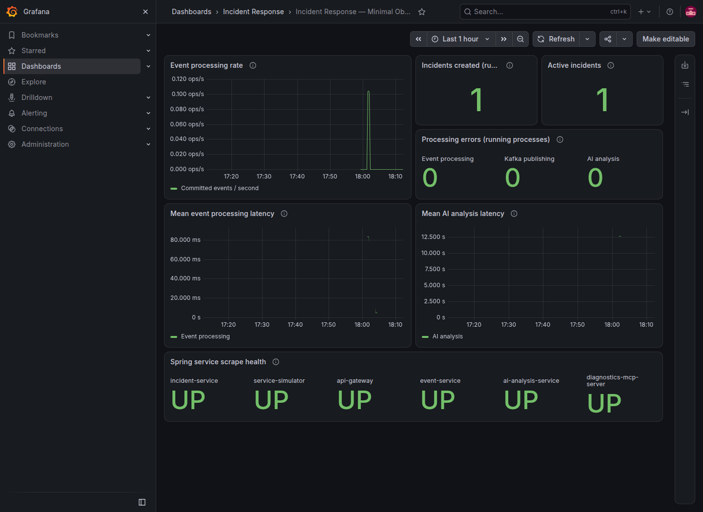

# Stage 16 — Verified minimal observability

Status: COMPLETE. Verified on November 18, 2026, using an isolated Compose project. All requested observability acceptance checks passed. No commits/pushes, framework upgrades or unrelated features were performed.

## Architecture and dependencies

```text
Spring Boot services → Micrometer → /actuator/prometheus → Prometheus → Grafana
```

The existing six applications retain their original processing and networking boundaries. Prometheus/Grafana are observers, not application dependencies. No detection threshold, Kafka topology/key/group/ack/retry, Redis behavior, migration, API DTO/route, MCP tool flow or AI prompt/model/tool-loop behavior was changed. The sole Kubernetes manifest edit is the shared Actuator allowlist/access; the running cluster was not redeployed.

Added `io.micrometer:micrometer-registry-prometheus` to each of the six module POMs, with versions managed by the existing Spring Boot parent. Java21, Boot4.0.9, JUnit5.13.4, Spring AI2.0.1 and existing Spring Cloud pins are unchanged. Built-in Boot Logstash JSON logging requires no new logging dependency.

Prometheus v3.16.0 and Grafana13.3.1 use verified version/digest-pinned official images. Configuration mounts are read-only, published host ports bind loopback, and each observer has a healthcheck, persistent data volume and dropped capabilities. Grafana requires an external password, disables anonymous access/signup, and receives no provider API key. Original database/Kafka volume definitions and all service-to-service DNS routes are preserved.

## Configuration and dashboard

- `observability/prometheus/prometheus.yml`: six direct service-DNS scrape jobs, `/actuator/prometheus`, 15-second scrape/evaluation interval and 5-second scrape timeout. TSDB retention is seven days.
- `observability/grafana/provisioning/datasources/datasource.yml`: default `Prometheus`, stable UID `prometheus`, proxy URL `http://prometheus:9090`.
- `observability/grafana/provisioning/dashboards/default.yml`: repository dashboard provisioning, 30-second rescan, no UI overrides.
- `observability/grafana/dashboards/incident-response.json`: one dashboard, UID `incident-response`, seven panels and nine queries.

Panels: committed event rate; committed incident creations by running processes; current global active incidents; processing/publish/analysis errors; mean event-processing latency; mean whole-analysis latency; per-service scrape health. Rates and latency are real Prometheus observations, not generated example data. Mean latency is not a percentile.



The screenshot shows the actual failure burst, one creation, one active incident, zero observed business errors, positive processing/analysis latency and all six scrape targets UP. The view uses Last1hour to retain the short scenario burst; the dashboard's normal default is Last15minutes. Idle current rates can legitimately return to zero, and an old burst eventually leaves the selected window.

## Custom metrics and semantics

| Micrometer meter | Type | Export / bounded dimensions |
| --- | --- | --- |
| `event.received` | Counter | `event_received_total`; valid normalized acceptance attempts |
| `event.published` | Counter | `event_published_total`; broker-confirmed publications |
| `event.publish.errors` | Counter | `event_publish_errors_total`; failed publish attempts |
| `event.publish.duration` | Timer | `event_publish_duration_seconds_*`; outcome=success/error |
| `incident.events.processed` | Counter | `incident_events_processed_total`; newly inserted committed events |
| `incident.events.duplicates` | Counter | `incident_events_duplicates_total`; duplicate deliveries observed |
| `incident.events.errors` | Counter | `incident_events_errors_total`; failed processing attempts |
| `incident.events.processing` | Timer | `incident_events_processing_seconds_*`; outcome=success/duplicate/error |
| `incident.incidents.created` | Counter | `incident_incidents_total`; source=manual/correlation, afterCommit only |
| `incident.incidents.active` | Gauge | `incident_incidents_active`; current DB OPEN+INVESTIGATING count |
| `analysis.requests` | Counter | `analysis_requests_total`; outcome=success/error |
| `analysis.errors` | Counter | `analysis_errors_total`; outcome=error |
| `analysis.duration` | Timer | `analysis_duration_seconds_*`; outcome=success/error, whole attempt |

All custom meters use the fixed `application` identity, plus only the listed bounded dimensions. Runtime exporter checks found 33 custom sample series with only application/outcome/source labels. The actual scenario event/trace/incident identifiers were absent from all six exporters.

Counters/timers are process-local and reset on restart. Incident success counts wait for commit; rollback/unknown completion cannot be reported as committed success. Runtime measurement failures do not replace business results or original exceptions. Zero-initialized AI meters do not record fictitious requests or timer observations.

The active gauge reads persistent state using an independent read-only transaction/query with a 3-second timeout. Failed reads report NaN rather than zero. Each replica reads the same logical database: use max, not sum, across incident replicas. Gauge state is independent of Redis and JVM counter lifetime.

Important export detail found during live verification: the modern registry client normalizes reserved suffixes. Micrometer `incident.incidents.created` exports as `incident_incidents_total`, NOT `incident_incidents_created_total`. The dashboard, documentation, packaging contract and actual HTTP export assertions use the observed name. No application restart or replayed simulation/provider call was needed to correct the provisioned query.

Timers retain cumulative count/sum, while their recent-window max can decay to zero after inactivity. Use the recorded sum/count and the scenario time range rather than treating a later max=0 as missing instrumentation.

## Automated verification

Final native Windows command, with no test exclusions or live-provider profile:

```powershell
Set-Location 'C:\Users\Shiva Sravani\Desktop\incident-response'
$env:JAVA_HOME = 'C:\Program Files\Java\jdk-21'
$env:PATH = "$env:JAVA_HOME\bin;$env:PATH"
$env:MAVEN_ARGS = ''
.\mvnw.cmd -B -ntp test
```

BUILD SUCCESS. Fresh Surefire results were aggregated programmatically:

| Module | Tests | Failures | Errors | Skipped |
| --- | ---: | ---: | ---: | ---: |
| incident-service | 161 | 0 | 0 | 0 |
| api-gateway | 30 | 0 | 0 | 0 |
| event-service | 74 | 0 | 0 | 0 |
| service-simulator | 40 | 0 | 0 | 0 |
| diagnostics-mcp-server | 159 | 0 | 0 | 0 |
| ai-analysis-service | 117 | 0 | 0 | 0 |
| TOTAL | 581 | 0 | 0 | 0 |

Includes the existing real PostgreSQL/Kafka/Redis Testcontainers suites and EventApplicationIntegrationTest; no infrastructure integration class was excluded. Normal AI tests use mocks or private loopback SDK fixtures, never the real provider.

Additional checks:
- 21 Python packaging/manifest/observability contract tests passed.
- 27 native Windows Pester smoke-contract tests passed, no skips/pending/inconclusive results.
- Real image `promtool check config` passed.
- All six applications were built from source into separate images and started successfully. Image assembly skips test execution only; the independent complete native suite above passed.
- Actual Grafana empty-password one-off startup guard rejected empty credentials with expected exit2.
- 91 documentation PowerShell blocks were syntax-parsed with zero errors, without executing setup or credential prompts.
- `git diff --check` passed; private env files remain ignored/untracked.

Focused regressions cover commit/rollback/commit-failure counters, duplicate behavior, database gauge/status changes, success/error timing, bounded metric labels, trace-context restoration, sanitized logging and telemetry failures preserving original business outcomes. Endpoint tests protect the chosen read-only allowlist/export contract; no framework version was upgraded.

Native Windows host caveat: unrestricted CPU gauge sampling blocked in JDK OperatingSystemImpl.getCpuLoad0 during the earlier worker investigations. Only affected observability TEST fixtures disable system.cpu/process.cpu meters. Production configuration remains unrestricted; all six Linux-container exporters were successfully scraped by Prometheus within the configured timeout.

Earlier attempts are not hidden: the pre-pause reactor was intentionally cancelled at the user's request (exit1, not a completed regression run). Expected RED failures caught unsafe telemetry and missing zero baselines. A subsequent run caught an old discovery-links expectation after deliberately disabling discovery; it was corrected to the intended404 contract. Final complete acceptance execution passed after the export-query assertion was also added.

## Actual live scenario

Selected project: `incident-response-stage16`, ordered env files `.env` then `.env.stage16-verification-6b45f6dc`. The private override contains only locally retained credentials/isolated host ports and is not a file to commit or print. Existing projects and Kubernetes data were not used for this smoke.

Before writes, all six exporters responded HTTP200, the exact incident list was empty, business counters/gauge were zero, and Prometheus reported all six targets UP. Every service returned404 for tested sensitive Actuator paths, including env/configprops/heapdump/loggers/beans/shutdown, and for disabled `/actuator` discovery. health/info/metrics/prometheus were200.

Exactly one failure-scenario POST and one real analysis HTTP POST were sent by the existing bounded smoke script, with no automatic POST retry. A single analysis request can involve several bounded internal model rounds; no claim of exactly one provider invocation is made.

```powershell
$files = @('.env', '.env.stage16-verification-6b45f6dc')
.\scripts\smoke-docker.ps1 -ProjectName 'incident-response-stage16' -EnvFile $files -Gateway 'http://127.0.0.1:28081' -IncludeAi
```

The command above records what was executed. Do not replay it against this retained database: the smoke deliberately rejects preexisting order-service history/incidents before writing. A repeat creation test requires a fresh isolated project/ports/credentials, not deletion of these audit records.

Observed handles:

- Incident: `e7eb32e8-24f0-4c8d-a49d-ab86a559447a`
- Trace: `5cba4453-49e3-4762-825b-b6896638ef19`

- Five unique events accepted, persisted, matched in Kafka and observed in Redis correlation members.
- One automatic HIGH order-service incident created at the configured error threshold5.
- After real AI analysis, exact incident readback remained OPEN/errorCount5: analysis did not mutate it.
- Analysis returned a validated response with actual mandatory diagnostics/evidence references. This verifies the response/evidence contract, not semantic truth of every model sentence.

| Observation | Before scenario | After scenario/analysis |
| --- | ---: | ---: |
| Newly committed events | 0 | 5 |
| Confirmed publications | 0 | 5 |
| Committed incident creations | 0 | 1 |
| Active incident gauge | 0 | 1 |
| Successful event timer observations | 0 | 5 |
| Successful event processing total seconds | 0 | 0.418364085 |
| Successful analysis observations | 0 | 1 |
| Whole-analysis total seconds | 0 | 12.646987881 |
| Processing/publish/analysis error counters | 0 | 0 |

An additional single duplicate eventId publication was intentionally tested AFTER that smoke, without another simulation/analysis. Publications became6; committed unique events remained5, duplicate count became1, timer outcomes were5 success +1 duplicate, persisted rows stayed5, and incident creation/active count remained1. The cumulative processing timer sum after the duplicate was0.423455483seconds. No synthetic incident was resolved or reset; one OPEN row is retained for inspection.

Direct PostgreSQL inspection confirmed OPEN|1 and five incident_events rows, matching the gauge and REST state. Real PostgreSQL automated tests also cover OPEN/INVESTIGATING/RESOLVED gauge transitions.

## Trace/log verification

Scoped MDC JSON logs matched the exact returned trace through:

| Custom business message | Count after duplicate probe |
| --- | ---: |
| Received event | 6 |
| Published event | 6 |
| Event consumed | 6 |
| Event processing prepared for commit | 5 |
| Correlation window evaluated | 5 |
| Automatic incident creation prepared for commit | 1 |
| Duplicate event ignored | 1 |

Custom processing logs contain identifiers, not event messages/metadata/raw exceptions/credentials. Creation logs deliberately say prepared for commit; durable success is established by counters and the database after commit. Existing framework initialization records are not counted as business-flow evidence. IDs occur in logs, never custom metric labels.

## Prometheus/Grafana acceptance

All six configured target names reported UP: incident-service, event-service, api-gateway, diagnostics-mcp-server, ai-analysis-service, service-simulator. Grafana datasource health returned OK and provisioned dashboard metadata matched the repository.

All nine queries across the seven panels returned nonempty real data through Grafana's own datasource proxy. Recorded examples: creations1, active1, three error signals0, six healthy scrape series, positive event-rate burst, approximately0.083673seconds mean event latency during the original failure, and12.646987881seconds analysis latency. A real browser rendered those values and graphs, including all six UP indicators; the screenshot above is from that running stack.

The headless browser initially kept the tab hidden, which paused panel rendering. Activating only the agent-owned browser tab allowed normal rendering; no application/Grafana workaround was introduced for that automation condition.

## All requested acceptance criteria

| # | Criterion | Verified evidence |
| --- | --- | --- |
| 1 | Existing application services start | Six source-built apps healthy in Compose |
| 2 | Prometheus starts in Compose | Healthy real container and readiness endpoint |
| 3 | Grafana starts in Compose | Healthy real container and database health |
| 4 | Spring scrape targets healthy | All six UP |
| 5 | Exporter exposes custom metrics | Actual exports and HTTP export regressions |
| 6 | Simulation increases event metrics | Zero baseline to5 committed events |
| 7 | Incident creation increases metrics | Zero baseline to1 committed creation |
| 8 | Active gauge reflects state | Zero to1; PG OPEN|1 matches REST/gauge; automated status transitions |
| 9 | Event timer records durations | Five success observations with positive sum; then one duplicate observation |
| 10 | AI timer records duration | One real successful analysis,12.646987881seconds |
| 11 | traceId in processing logs | Matched exact trace across seven business message types |
| 12 | Grafana receives Prometheus data | Datasource health OK and real proxy query results |
| 13 | Dashboard displays real scenario values | Rendered seven-panel screenshot, not fixture data |
| 14 | All automated tests pass | 581 JVM +21 packaging +27 Pester; zero failures/errors/skips |

## Retained URLs and operator commands

The VERIFIED isolated stack uses these host URLs (not the native/default stack):

- Gateway: http://127.0.0.1:28081
- Incident metrics: http://127.0.0.1:28080/actuator/prometheus
- Prometheus: http://127.0.0.1:19090
- Prometheus targets: http://127.0.0.1:19090/targets
- Grafana dashboard: http://127.0.0.1:13000/d/incident-response?from=now-1h&to=now

Grafana username is admin; its password is stored only in the private ignored override. Open that file locally if needed; never paste its contents into chat or Git. Default ports for a separately configured full stack remain Prometheus9090/Grafana3000; these are not the isolated verification bindings.

Run read-only inspection in a free Windows PowerShell terminal:

```powershell
Set-Location 'C:\Users\Shiva Sravani\Desktop\incident-response'
$obsDc = @('--project-name','incident-response-stage16','--env-file','.env','--env-file','.env.stage16-verification-6b45f6dc')
docker compose @obsDc ps --all
curl.exe --fail http://127.0.0.1:28080/actuator/metrics/incident.events.processed
curl.exe --fail http://127.0.0.1:28080/actuator/metrics/incident.incidents.active
Invoke-RestMethod 'http://127.0.0.1:19090/api/v1/targets'
```

To start/rebuild this SAME project later, preserving volumes:

```powershell
docker compose @obsDc up -d --build --wait --wait-timeout 300
```

Every new terminal needs Set-Location and the same argument array again. Restarting/recreating a process resets its counters/timers, not persistent incidents or the DB gauge. Select a chart time range containing the burst, or use a fresh isolated project for a new creation smoke. Do not start a native copy on these ports or use an old project's incident UUID. Stopping only this project with `docker compose @obsDc stop` preserves data; no down -v was run.

Reproduce the offline configuration/script checks:

```powershell
python -m unittest discover -s tests/packaging -v
$r = Invoke-Pester -Script @('.\scripts\tests\smoke-docker.Tests.ps1','.\kubernetes\tests\demo-load-balancing.Tests.ps1') -PassThru
if ($r.FailedCount -gt 0) { throw 'PowerShell contract tests failed' }
```

Packaging checks require Python with PyYAML, Docker Compose CLI and kubectl client, as in the existing packaging prerequisites. Neither those checks nor Pester invokes a real provider.

## Completion / retained state

No Stage16 acceptance item remains incomplete. Eleven long-running containers remain healthy, kafka-init completed successfully, and synthetic audit/metrics/Grafana data are retained. The two existing Compose projects remained running9 and running3 respectively; no user application or infrastructure was stopped/reconfigured. Kubernetes was not redeployed, so its old images do not yet contain this new instrumentation; that is outside the completed Compose verification, not a claimed Kubernetes observability rollout.

No production security/HA monitoring, centralized log system, distributed tracing, alerts or unrelated future stages were introduced. Local unauthenticated metrics/Prometheus still require proper network/authentication controls before public deployment. The known preexisting MCP protocol-error stackTrace path is not changed by this stage; controlled downstream errors and the new custom processing logs retain their existing sanitization boundaries.

## Files created/modified

Full working-tree file inventory for this stage (private ignored env files are deliberately excluded):

- `.env.example`
- `README.md`
- `ai-analysis-service/pom.xml`
- `ai-analysis-service/src/main/java/com/umass/analysis/service/AnalysisMetrics.java`
- `ai-analysis-service/src/main/java/com/umass/analysis/service/IncidentAnalysisService.java`
- `ai-analysis-service/src/main/resources/application.yaml`
- `ai-analysis-service/src/test/java/com/umass/analysis/AnalysisApplicationIntegrationTest.java`
- `ai-analysis-service/src/test/java/com/umass/analysis/service/AnalysisMetricInitializationTest.java`
- `ai-analysis-service/src/test/java/com/umass/analysis/service/IncidentAnalysisServiceTest.java`
- `api-gateway/pom.xml`
- `api-gateway/src/main/resources/application.yaml`
- `api-gateway/src/test/java/com/umass/gateway/GatewayRoutingIntegrationTest.java`
- `diagnostics-mcp-server/pom.xml`
- `diagnostics-mcp-server/src/main/resources/application.yaml`
- `docker-compose.yml`
- `docs/stage16-dashboard.png`
- `docs/stage16-resume.md`
- `docs/stage16-verification.md`
- `event-service/pom.xml`
- `event-service/src/main/java/com/umass/event/service/EventMetrics.java`
- `event-service/src/main/java/com/umass/event/service/EventService.java`
- `event-service/src/main/java/com/umass/event/service/EventTraceScope.java`
- `event-service/src/main/java/com/umass/event/service/KafkaEventPublisher.java`
- `event-service/src/main/resources/application.yaml`
- `event-service/src/test/java/com/umass/event/EventObservabilityApplicationTest.java`
- `event-service/src/test/java/com/umass/event/service/EventMetricsTest.java`
- `event-service/src/test/java/com/umass/event/service/EventServiceTest.java`
- `event-service/src/test/java/com/umass/event/service/EventTraceLoggingTest.java`
- `event-service/src/test/java/com/umass/event/service/KafkaEventPublisherTest.java`
- `incident-service/pom.xml`
- `incident-service/src/main/java/com/umass/incident/consumer/EventConsumer.java`
- `incident-service/src/main/java/com/umass/incident/observability/EventTraceScope.java`
- `incident-service/src/main/java/com/umass/incident/observability/IncidentMetrics.java`
- `incident-service/src/main/java/com/umass/incident/repository/IncidentRepository.java`
- `incident-service/src/main/java/com/umass/incident/service/CorrelationService.java`
- `incident-service/src/main/java/com/umass/incident/service/EventProcessingService.java`
- `incident-service/src/main/java/com/umass/incident/service/IncidentService.java`
- `incident-service/src/main/resources/application.yaml`
- `incident-service/src/test/java/com/umass/incident/IncidentPersistenceIntegrationTest.java`
- `incident-service/src/test/java/com/umass/incident/OperationalEndpointsIntegrationTest.java`
- `incident-service/src/test/java/com/umass/incident/config/ObservabilityConfigurationTest.java`
- `incident-service/src/test/java/com/umass/incident/consumer/EventConsumerTest.java`
- `incident-service/src/test/java/com/umass/incident/service/CorrelationServiceTest.java`
- `incident-service/src/test/java/com/umass/incident/service/EventProcessingServiceTest.java`
- `incident-service/src/test/java/com/umass/incident/service/EventProcessingTransactionMetricsTest.java`
- `incident-service/src/test/java/com/umass/incident/service/IncidentMetricsTest.java`
- `incident-service/src/test/java/com/umass/incident/service/IncidentServiceTest.java`
- `kubernetes/base/application-common.yaml`
- `observability/README.md`
- `observability/grafana/dashboards/incident-response.json`
- `observability/grafana/provisioning/dashboards/default.yml`
- `observability/grafana/provisioning/datasources/datasource.yml`
- `observability/prometheus/prometheus.yml`
- `service-simulator/pom.xml`
- `service-simulator/src/main/resources/application.yaml`
- `tests/packaging/test_compose.py`
- `tests/packaging/test_kubernetes.py`
- `tests/packaging/test_observability.py`
